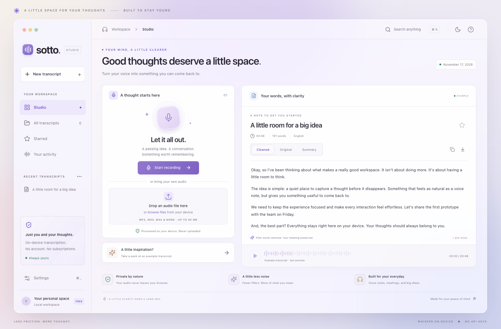
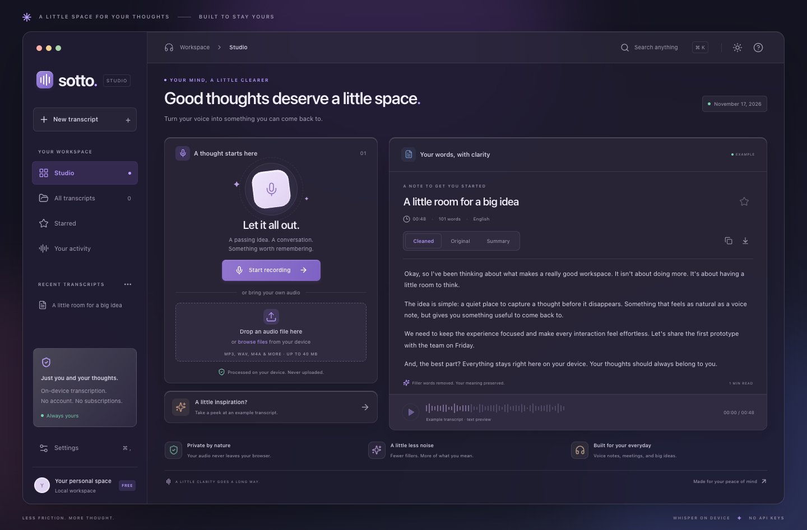

# Sotto

### A little space for your thoughts.

A private transcription workspace with a macOS-inspired glass interface. Record a thought, upload a recording, and turn it into words worth keeping. **Real Whisper transcription runs on your device. No API keys, subscriptions, Python server, or paid model services.**

[View on GitHub](https://github.com/muanpi969-jpg/sotto-transcription-studio) · [Deploy a copy to Vercel](https://vercel.com/new/clone?repository-url=https%3A%2F%2Fgithub.com%2Fmuanpi969-jpg%2Fsotto-transcription-studio)



## What you can do

- Record from your microphone or upload audio with drag and drop.
- Transcribe English speech using the open Whisper Tiny model in a Web Worker.
- Switch instantly between original text, local cleanup, and an extractive summary.
- Rename, star, search, and export transcripts as plain text.
- Browse a local transcript library and activity metrics.
- Choose light, dark, or system appearance, with persistent settings.
- Open the command palette with `⌘ K` / `Ctrl K`, or settings with `⌘ ,` / `Ctrl ,`.
- Explore a clearly labeled example without downloading a model.

## Run locally

Use Node.js 22.18+ and npm. Run commands from the **repository root**:

```bash
npm ci
npm run dev
```

Open [localhost:5173](http://localhost:5173). No `.env` file is needed. For a production preview:

```bash
npm run build
npm run preview
```

Microphone access requires HTTPS or localhost. Recent desktop Chrome or Edge is recommended. Other browsers can work if they support WebAssembly and can decode the selected audio format. MP3 and WAV have the widest compatibility.

## Deploy on Vercel

1. Push this project to a GitHub repository.
2. In Vercel, choose **Add New → Project** and import that repository.
3. Leave **Root Directory** at the repository root (`.`).
4. Deploy. The included `vercel.json` supplies these settings:

| Setting               | Value           |
| --------------------- | --------------- |
| Framework             | Vite            |
| Install command       | `npm ci`        |
| Build command         | `npm run build` |
| Output directory      | `frontend/dist` |
| Environment variables | None            |
| Node.js               | 22.x            |

Vercel only serves static files. No serverless functions, inference endpoints, external database, or backend hosting are needed. For a personal portfolio, the Vercel Hobby plan can host this within its [usage limits and terms](https://vercel.com/docs/plans/hobby). Hosting availability is subject to the provider's quotas; the app itself has no billable API path. A custom domain is optional.

If creating your own remote repository manually:

```bash
git remote add origin https://github.com/YOUR_USERNAME/sotto.git
git push -u origin main
```

If you downloaded a source ZIP without Git history, run `git init -b main`, `git add .`, and `git commit -m "Build Sotto transcription studio"` first. Do not include audio recordings, `.env` files, local caches, or virtual environments; the included `.gitignore` excludes them.

## How it works

1. The browser checks file size and type, decodes the audio, and converts it to mono 16 kHz PCM.
2. PCM samples move to a dedicated Web Worker so the interface stays responsive.
3. [Transformers.js](https://huggingface.co/docs/transformers.js) loads [Whisper Tiny English](https://huggingface.co/onnx-community/whisper-tiny.en) with quantized weights and runs inference through ONNX Runtime / WebAssembly.
4. Cleanup removes common filler words and obvious repetitions. Summaries select sentences already present in the cleaned transcript. These features use deterministic text processing, not a generative LLM.
5. Transcripts are saved to `localStorage`. Audio exists only in the current tab session. Nothing sends your audio to a remote API.

The model downloads from Hugging Face on first transcription. Expect tens of megabytes of model assets plus the WebAssembly runtime. The browser caches model assets when storage is available, but cache eviction can require a later download. The application shell is not an offline PWA. A working internet connection is required for the initial download; Hugging Face receives normal asset requests, not your recording.

Processing uses your device's CPU and memory. It can be slower than the audio duration on low-powered phones. Files are limited to **40 MB and 10 minutes** to keep resource usage predictable. Transcription is English-only and can make mistakes, especially with silence, names, accents, overlapping voices, or noise. Review important text.

## Privacy and local storage

- No accounts, telemetry, analytics, cookies for tracking, or API credentials.
- The 50 most recent transcripts are stored in the current browser and origin; the oldest is replaced when a new note exceeds this limit. Notes do not sync between devices or domains. Export anything you want to keep, and export before moving from localhost to a hosted URL.
- Browser storage is not encrypted; anyone with access to the same browser profile can read notes. Clearing site data removes them.
- Playback is available for the selected audio during this tab session. Reopened library notes contain text only.
- Settings offers a confirmation step before clearing saved transcripts. Storage errors are surfaced with an export reminder.
- Clinical formatting preserves dictated content and leaves medical section assignment to the reviewer. It does not infer diagnoses or produce a validated medical record. Use sample or non-sensitive audio for a public portfolio demonstration.

## Project structure

```text
frontend/
  src/
    App.tsx                   Workspace, library, activity, and settings
    components/ui.tsx         Reusable glass controls and accessible dialogs
    hooks/useRecorder.ts      Microphone lifecycle and codec selection
    lib/                      Audio, text processing, and local storage
    transcription.worker.ts   On-device Whisper inference
    styles.css                Light/dark design tokens and responsive layout
  scripts/prepare-ort.mjs      Copies matching WASM runtime assets at build time
  tests/                      Unit and Playwright browser tests
docs/                         Desktop and mobile screenshots
.github/workflows/ci.yml      Build and browser checks on push/PR
vercel.json                   Static deployment from the repository root
```

The previous FastAPI/OpenAI backend has been removed from the source. Local virtual environments or old caches, if present on an existing machine, are ignored and not used by this application.

## Verification

```bash
npm test
npm run build
npx playwright install chromium
npm run test:e2e
```

Browser tests cover sample viewing, export, theme persistence, command search, library search, favorites, renaming, activity, deletion confirmation, invalid files, microphone denial, glass rendering, and horizontal overflow at 320, 390, 768, 1024, and 1440 pixels. Tests automatically use an installed Google Chrome on macOS, or Playwright Chromium elsewhere.

To run the real model integration check (downloads public model assets and a public speech sample):

```bash
RUN_MODEL_TEST=1 npm run test:e2e -- --grep 'real on-device'
```

The model test verifies recognized speech, persistence, and that no audio POST request is made. Regular CI skips this download-heavy check. To test built static assets, run `TEST_PRODUCTION=1 npm run test:e2e` with no dev server already on port 5173.

## Optional Docker

```bash
docker compose up --build
```

Open [localhost:8080](http://localhost:8080). Docker now runs only the static Nginx frontend. The model still executes in your browser.

## Portfolio notes

This project demonstrates browser ML inference, transferable audio buffers, worker cancellation, microphone permissions and codec handling, a local-first data model, accessible dialogs, responsive design, theme tokens, CI, and static deployment. The calm visual system uses layered mesh gradients, frosted glass, subtle border highlights, and restrained violet accents. Reduced-motion preferences are respected.



## License

Application code: [MIT](LICENSE). Third-party libraries and Whisper weights retain their respective licenses; see the linked model card and package metadata.
